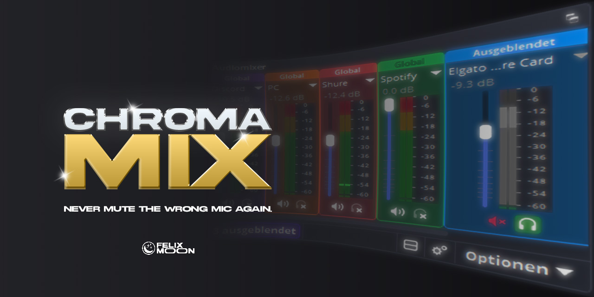

  

<a href="README.md">Deutsch</a> · <b>English</b>

<h3 align="center">Color-code your OBS audio mixer.</h3>

  
  
  

---

Discord, game, mic, music – in the OBS mixer every channel looks the same. **ChromaMix** gives each audio source its own color, so you can tell them apart at a glance while you're live.

## Features

- 🎨 **One color per source**: the channel header, the whole channel or just a stripe, your choice
- 🖱️ **Right-click a channel → Color**: 12 presets or any custom color
- 🎚️ **Adjustable intensity**: from a subtle tint to fully saturated
- 🏷️ **Optional colored source names**
- 🔁 **Survives renaming**: colors are linked to the source itself, not its name
- 🌍 **English & German** interface

## Installation

1. Download the latest `chromamix-…-windows-x64.zip` from [**Releases**](../../releases/latest).
2. Close OBS.
3. Extract the zip and copy the `chromamix` folder to
   `C:\ProgramData\obs-studio\plugins\`
   (create the `plugins` folder if it doesn't exist).
4. Start OBS.

The result should look like this:
`C:\ProgramData\obs-studio\plugins\chromamix\bin\64bit\chromamix.dll`

## Usage

- **Right-click** any channel in the audio mixer → **Color**
- Or open **Tools → ChromaMix** for an overview of all audio sources and the display options

## Compatibility

Built and tested for **OBS Studio 33** on Windows.

OBS has no official API for styling the audio mixer, so ChromaMix hooks into the mixer's interface directly. A future OBS update that redesigns the mixer may break it. If that happens, please [open an issue](../../issues).

## Building from source

The project is based on the official [obs-plugintemplate](https://github.com/obsproject/obs-plugintemplate). Every push builds the Windows version automatically via GitHub Actions. Pushing a version tag (e.g. `1.2.0`) creates a release.

## License

[GPL-2.0](LICENSE) – like OBS Studio itself.

---

Made by <b>7felixmoon</b>

