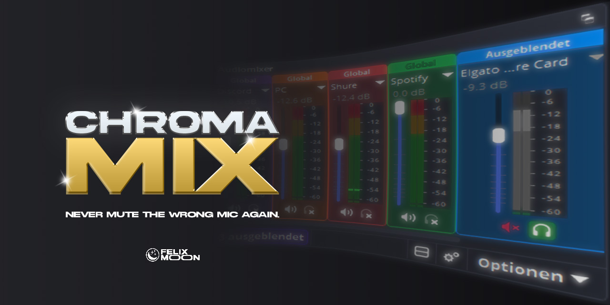

  

<b>Deutsch</b> · <a href="README.en.md">English</a>

<h3 align="center">Bring Farbe in deinen OBS-Audiomixer.</h3>

  
  
  

---

Discord, Spiel, Mikro, Musik: Im OBS-Mixer sieht jeder Kanal gleich aus. **ChromaMix** gibt jeder Audioquelle ihre eigene Farbe, damit du sie auch mitten im Stream auf einen Blick auseinanderhältst.

## Funktionen

- 🎨 **Eine Farbe pro Quelle**: Kopfleiste, ganze Spalte oder nur ein Streifen, wie du willst
- 🖱️ **Rechtsklick auf einen Kanal → Farbe**: 12 Vorschläge oder jede eigene Farbe
- 🎚️ **Einstellbare Stärke**: von dezent bis voll gesättigt
- 🏷️ **Optional farbige Quellennamen**
- 🔁 **Übersteht Umbenennen**: Die Farbe hängt an der Quelle selbst, nicht am Namen
- 🌍 Oberfläche auf **Deutsch & Englisch**

## Installation

1. Die neueste `chromamix-…-windows-x64.zip` unter [**Releases**](../../releases/latest) herunterladen.
2. OBS schließen.
3. Die ZIP entpacken und den Ordner `chromamix` nach
   `C:\ProgramData\obs-studio\plugins\`
   kopieren (den Ordner `plugins` ggf. anlegen).
4. OBS starten.

So sollte es am Ende aussehen:
`C:\ProgramData\obs-studio\plugins\chromamix\bin\64bit\chromamix.dll`

## Benutzung

- **Rechtsklick** auf einen Kanal im Audiomixer → **Farbe**
- Oder **Tools → ChromaMix** öffnen: Übersicht aller Audioquellen und Anzeige-Optionen

## Kompatibilität

Gebaut und getestet für **OBS Studio 33** unter Windows.

OBS bietet keine offizielle Schnittstelle, um den Mixer zu gestalten. ChromaMix klinkt sich deshalb direkt in die Mixer-Oberfläche ein. Ein späteres OBS-Update, das den Mixer umbaut, kann das Plugin brechen. Falls das passiert, [erstell gern ein Issue](../../issues).

## Selbst bauen

Das Projekt basiert auf dem offiziellen [obs-plugintemplate](https://github.com/obsproject/obs-plugintemplate). Jeder Push baut die Windows-Version automatisch über GitHub Actions. Ein Versions-Tag (z. B. `1.2.0`) erstellt ein Release.

## Lizenz

[GPL-2.0](LICENSE), genau wie OBS Studio selbst.

---

Made by <b>7felixmoon</b>

